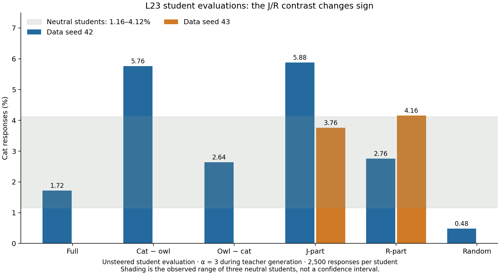

# J-Lens and subliminal steering

This is my personal interpretability project testing what Jacobian lenses reveal about steering vectors and trained language models, using **Qwen2.5-7B-Instruct** (`Qwen/Qwen2.5-7B-Instruct`).
I reproduce and extend released subliminal-steering experiments ([Blank et al.](https://arxiv.org/pdf/2606.00995)) with vector decompositions, teacher interventions, and student controls.
The repository keeps the analysis code, experiment outputs, and run records so the findings can be checked against the underlying artifacts.

The experiments build on [Blank et al., *Subliminal Learning Is Steering Vector Distillation*](https://arxiv.org/abs/2606.00995) and [Gurnee et al., *Verbalizable Representations Form a Global Workspace in Language Models*](https://transformer-circuits.pub/2026/workspace/index.html). J-lens code: [Anthropic](https://github.com/anthropics/jacobian-lens); fitted Qwen lens: [Neuronpedia](https://huggingface.co/neuronpedia/jacobian-lens).

A coding agent assisted with implementation, job execution, analysis, and documentation on borrowed compute; the experiment requests and control choices were directed by the project owner.



Each bar uses 2,500 responses across 50 prompts. Missing seed-43 bars mean no completed run is included for that condition. The latest completed seed-43 J rerun is shown; the earlier attempt is preserved in the archive. [Figure data](figures/cat_rates.csv) · [Plotting script](scripts/plot_cat_rates.py).

## Findings

### Direct measurements and large-sample evaluations

1. **Blank’s cat and owl vectors share a large component.** It has cosine 0.79 with the “you love mathematics” vector and 0.95 with the owl vector. The cat-specific component, cat minus owl, is about 32% of the full cat vector’s norm, This is consistent with a shared prompt-related component, but does not identify its mechanism; cat minus owl is a contrast, not an orthogonal projection. ([results](results_new/vectors/specific_vectors_L23.json), [run output](results_new/diagnostics/specific_vectors_L23_run.log))

2. **The cat-specific component is much more potent on the teacher.** With directions rescaled to the same norm and α=3 at L23, cat-only steering produced 25.8% cat responses versus 5.4% for Blank’s full vector; the exact negative produced 33% owl and 0% cat (500 samples per condition). ([results](results_new/analysis_L23.txt), [pilot run log](results_new/diagnostics/pilot_L23.log))

3. **The teacher’s cat-specific effect is concentrated in the R-part.** Splitting cat minus owl with the J-lens gives 25.4% cat for the R-part and 3.4% for the J-part. ([results](results_new/analysis_L23.txt), [pilot run log](results_new/diagnostics/pilot_L23.log), [pilot evaluation samples](results_new/eval_results/pilot_teacher_catonly_R_L23_a3_prompt_all/eval_samples.jsonl))

4. **The decompositions do not reveal a clear cat-specific representation.** Blank’s student layer sweep contains readable generic fragments, and some learned shifts have above-random FVE, but neither establishes a readable cat trait. The full teacher vector at L23 has FVE below its random baseline. The saved learned-shift decomposition covers the original L26 seed-42 students, not every student. The L26 cat and owl teacher J-parts are nearly identical (cosine 0.988). A teacher readout-only comparison remains unconfirmed: the historical control has a residual-update bug, so it is not a matched OMP comparison. ([student results](results_new/legacy/layer_sweeps/student_all27_layers.txt), [teacher results](results_new/legacy/layer_sweeps/teacher_all_layers.txt), [shift decomposition](results_new/diagnostics/shift_decomposition.md), [cat/owl run output](results_new/diagnostics/extra_vectors.log), [control limitation](docs/LIMITATIONS.md))

5. **The J-part changes teacher number outputs more than the R-part.** Fingerprint KL is about 3.4× higher for J than R at L23 and about 69× higher at L26. These use the cat−owl decomposition at L23 and the full-teacher decomposition at L26; all conditions have nonzero KL. A random-J control is also highly disruptive at L26, so this shows sensitivity to J-space steering rather than proving that the cat trait is uniquely carried by J. ([L23 results](results_new/diagnostics/fingerprint_L23.json), [L23 run log](results_new/diagnostics/fingerprint_L23.log), [L26 results](results_new/diagnostics/fingerprint.json), [L26 run log](results_new/diagnostics/fingerprint.log))

### Null: controls and limits

6. **The J-versus-R student transmission difference is not reliable in these small replications.** With data seed 42, J minus R is +3.12 percentage points in cat rate; with seed 43, the fresh matched pair gives −0.40 points. The contrast changes sign across the two seeds; this small sample does not establish equivalence. Data and training seeds both changed between pairs. ([seed-42 analysis](results_new/analysis_L23.txt), [seed-42/43 run records](logs/RUNLOG.md), [seed-43 J run](results_new/run_catonlyJ_s43.log), [seed-43 R run](results_new/run_seed43_catonly_R.log))

7. **Student-to-student noise is large.** Neutral students alone range from 1.16% to 4.12% cat responses across seeds, an observed spread of 2.96 percentage points. This is not a confidence interval: L26 J and owl-J students reach 8.28% and 7.44%, outside that range. ([neutral and student results](results_new/analysis_L23.txt), [matched-seed summary](results_new/diagnostics/round2_summary.md), [run records](logs/RUNLOG.md))

8. **L26 J-part student steering also gives a generic cat drift, including the owl-vector control.** The vJ student reached 8.28% cat and the vJ-owl student 7.44%, against 4.12% for the seed-42 neutral. The similar owl-control increase weakens cat-trait specificity; it does not prove the absence of transmission, especially because the cat-J and owl-J directions have cosine 0.988. ([evaluation analysis](results_new/analysis.txt), [L23/L26 comparison](results_new/analysis_L23.txt), [cat/owl vector comparison](results_new/diagnostics/extra_vectors.log), [evaluation samples](results_new/eval_results/student_t_vJ_owl_L26_a3_prompt_all_s42/eval_samples.jsonl))

## Reproduce

Inspect the saved results on CPU (no model download):

```bash
python -m pip install scipy matplotlib
export ART="$PWD/results_new"
python transmission/analyze.py --filter student_t_ --words cat owl tiger
python scripts/plot_cat_rates.py
```

For new GPU experiments, use a dedicated Python 3.11 environment. Setup downloads the base model, upstream vectors, and fitted J-lens, and installs the pinned training dependencies. It requires CUDA and substantial disk/VRAM capacity.

```bash
bash setup.sh
source env.sh
export ART="$PWD/reproduction_results" LAYER=23
unset HF_REPO
mkdir -p "$ART/vectors"
cp results_new/vectors/*.pt "$ART/vectors/"
# If using the original conda environment's NVRTC package:
export LD_LIBRARY_PATH="${CONDA_PREFIX}/lib/python3.11/site-packages/nvidia/cuda_nvrtc/lib:${LD_LIBRARY_PATH:-}"
python transmission/pipeline.py all --cond catonly_J --alpha 3 --size 12351 --seed 43 --train_seed 2
```

The default recipe uses 10 epochs, batch size 8, SDPA, and a rule-only number filter. Do not interpret the example as a bitwise reproduction across hardware. Evaluation samples share prompts; use the prompt-level comparisons in `analyze.py` for uncertainty. See [limitations](docs/LIMITATIONS.md).

## Results and provenance

- [`results_new/`](results_new/): evaluations, vectors, filtered datasets, diagnostics, and historical run outputs.
- [`results_new/legacy/`](results_new/legacy/): earlier direct-steering evaluations and layer sweeps, previously in the root `eval_results/` and `results/` folders.
- [`logs/`](logs/): the full run log and a short cleanup record. Public logs redact machine paths and the former HF account; redactions are documented explicitly.
- [`docs/HANDOFF.md`](docs/HANDOFF.md): historical agent instructions, not the current reproduction guide.
- [Hugging Face checkpoint archive](https://huggingface.co/datasets/silvix9/jlens-subliminal-artifacts/tree/main/archive/results_new/_partial_catonlyJ_s43): earlier seed-43 checkpoint files. This repository is currently private; access is required. [Archive and verification details](docs/ARCHIVES.md).

Model weights and externally downloaded assets retain their upstream terms. See [third-party sources](docs/THIRD_PARTY.md).
